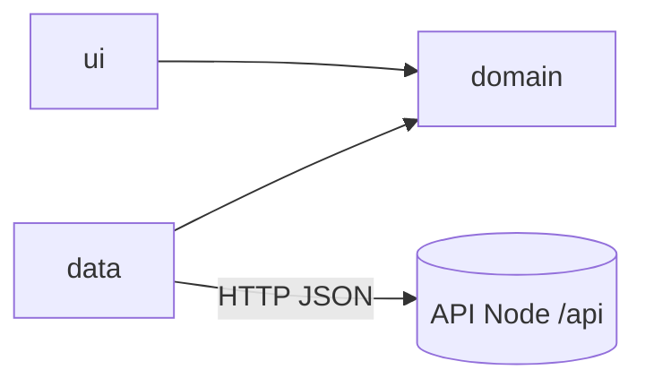

# Módulo móvil Android - Registro y Login (GA8-220501096-AA2-EV02)

Aplicación Android (Kotlin) que consume el servicio web REST de este mismo repositorio
(`src/`, Node.js + Express, ver `README.md`): registro (`POST /api/registro`) e inicio de
sesión (`POST /api/login`).

- Repositorio (URL): https://github.com/duviergutierrezalvarez78-netizen/GA7-AA5-EV01-registro-login
- APK compilado: `dist/RegistroLoginMovil-debug.apk`

## Arquitectura por capas / paquetes

Paquete base: `co.edu.sena.registrologin` (`app/src/main/java/...`)

| Paquete  | Contenido | Responsabilidad |
|----------|-----------|-----------------|
| `ui`     | `LoginActivity`, `RegisterActivity`, `HomeActivity`, `UiKit` | Presentación; `UiKit` agrupa componentes reutilizables (campos, botones, ejecución en segundo plano) |
| `domain` | `AuthUseCase`, `AuthRepository` (interfaz), `AuthResult`, `Validador` | Reglas de negocio, sin dependencias de Android |
| `data`   | `AuthRepositoryHttp`, `JsonUtil` | Acceso a datos: cliente HTTP hacia la API |

Patrones: Repository + inversión de dependencias (domain define la interfaz, data la implementa),
Use Case, resultado sellado (`sealed class AuthResult`).



## Mapa de navegación

`LoginActivity` (inicio) → `HomeActivity` si la autenticación es satisfactoria; 
`LoginActivity` ⇄ `RegisterActivity` (al registrar vuelve al login); `HomeActivity` → cerrar sesión → `LoginActivity`.

## Ambiente de desarrollo

| Elemento | Versión usada |
|----------|---------------|
| SO | Windows 11 |
| JDK | OpenJDK 17 |
| Android SDK | compileSdk 36, minSdk 24, targetSdk 36 (build-tools 35/36) |
| Gradle / AGP / Kotlin | 8.13 (wrapper) / 8.13.0 / 2.0.21 |
| IDE | Android Studio (abrir la carpeta raíz del repositorio) |
| Control de versiones | Git + GitHub |
| Backend | Node.js 18+ (`npm install && npm start`, puerto 3000) |

Configuración de servidor y acceso a datos: la URL base de la API está en
`app/build.gradle.kts` (`API_BASE_URL`, por defecto `http://10.0.2.2:3000/api`, que es el
`localhost` de la PC visto desde el emulador). Para un teléfono físico, cambiarla por la IP LAN
de la PC. Se permite tráfico HTTP sin cifrar (`usesCleartextTraffic`) solo por ser un ambiente de
desarrollo; en producción usar HTTPS.

Crear `local.properties` con `sdk.dir=<ruta del SDK>` (Android Studio lo genera; está ignorado por Git).

## Ambiente de pruebas

- Pruebas unitarias JUnit 4 (`app/src/test/.../AuthModuloTest.kt`): validaciones, casos de uso de login/registro con un repositorio falso y serialización JSON.
- Ejecutar: `gradlew.bat testDebugUnitTest` (Linux/Mac: `./gradlew testDebugUnitTest`). Resultado actual: 10 pruebas, 0 fallos.
- Prueba manual: iniciar el backend (`npm start`), abrir un emulador (API 24+), instalar el APK y registrar/iniciar sesión.

## Compilar el APK

```
gradlew.bat assembleDebug
```
Salida: `app/build/outputs/apk/debug/app-debug.apk` (copia entregada en `dist/`).

## Instalación

`adb install dist/RegistroLoginMovil-debug.apk`
